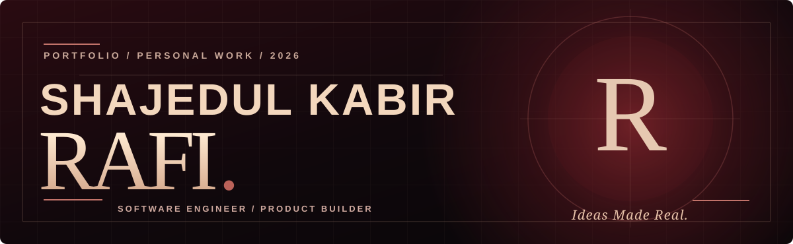

<!-- GitHub profile README for github.com/Rafi12234 -->

  
    
  <strong>Building products that feel considered, useful, and unmistakably human.</strong>
    
  
  
  

---

### 01 / HELLO, I'M RAFI

I'm **Shajedul Kabir Rafi**, a software engineer based in Dhaka, Bangladesh, working across full-stack web applications, mobile products, and applied AI.

I care about the full journey of a product: understanding the problem, shaping the interface, building reliable systems, and refining the details that make software enjoyable to use. Beyond product engineering, I explore computer vision, research, and experimental digital experiences.

> **Ideas made real. Engineering with intention.**

### 02 / CURRENT CHAPTERS

| Where I build | What I do |
| :-- | :-- |
| **DataPulse Global** | Junior Software Engineer · Dhaka · Jun 2026 – Present |
| **Boraq** | Full Stack Developer · Remote · Jun 2026 – Present |
| **AUST Robotics Club** | Director, Web & App Development · Jul 2026 – Present |

My university engineering work and research are connected to Ahsanullah University of Science and Technology (AUST).

### 03 / SELECTED WORK

The work spans production workflows, mobile tools, creative frontends, and experiments in intelligent systems. Here are six of the public repositories I enjoy sharing.

<table><tbody>
<tr>
<td width="50%" valign="top">
   
  <strong><a href="https://github.com/Rafi12234/Make-My-Event-Office-Management-System">MAKE MY EVENT ↗</a></strong> 
  Office operations, meeting coordination, records, and event-management workflows. 
  Management systems · Prisma · MySQL
</td>
<td width="50%" valign="top">
   
  <strong><a href="https://github.com/Rafi12234/Sicko-Soul-Website">SICKO SOUL ↗</a></strong> 
  A motion-led, editorial streetwear web experience with expressive interactions. 
  Next.js · GSAP · Lenis · OGL
</td>
</tr>
<tr>
<td width="50%" valign="top">
   
  <strong><a href="https://github.com/Rafi12234/SafePath-BD">SAFEPATH BD ↗</a></strong> 
  Road-safety reporting and incident-aware route exploration on real maps. 
  ASP.NET Core · C# · Leaflet · OSRM
</td>
<td width="50%" valign="top">
   
  <strong><a href="https://github.com/Rafi12234/AUST-Robotics-Club-Mobile-Application">AUST ROBOTICS MOBILE ↗</a></strong> 
  Cross-platform club application for events, updates, and the robotics community. 
  Flutter · Dart · REST APIs
</td>
</tr>
<tr>
<td width="50%" valign="top">
   
  <strong><a href="https://github.com/Rafi12234/AI-ASSISTED-DEEPFAKE-IMAGE-AND-VIDEO-DETECTION-SYSTEM">DEEPFAKE DETECTION ↗</a></strong> 
  AI-assisted media verification exploring risk signals and human review. 
  Next.js · FastAPI · PyTorch · OpenCV
</td>
<td width="50%" valign="top">
   
  <strong><a href="https://github.com/Rafi12234/FlareSphere-Real-Time-Hand-Tracking-Fireball-Effect">FLARESPHERE ↗</a></strong> 
  Gesture-controlled particles and cinematic fireball visuals using hand tracking. 
  React · MediaPipe · Canvas
</td>
</tr>
</tbody></table>

Project cover images are conceptual portfolio artwork, not verified screenshots of the apps. Individual repositories describe their current implementation status.

   
  <a href="https://shajedulkabir.me"><strong>Explore the full 18-project portfolio ↗</strong></a>
  &nbsp;&nbsp;·&nbsp;&nbsp;
  <a href="https://github.com/Rafi12234?tab=repositories"><strong>Browse all repositories ↗</strong></a>
    

### 04 / RESEARCH & EXPLORATION

My research interests span **multimodal AI, computer vision, trustworthy systems, geospatial intelligence, and medical-image analysis**. The portfolio distinguishes accepted work from submitted proposals and ongoing investigations.

| Research direction | Current record |
| :-- | :-- |
| **BanglaFakeMMD** · multimodal Bangla fake-news detection | Accepted & presented |
| **Visual Inattention Profiling** · driver monitoring with YOLO and OCR | Accepted for presentation |
| **CA-DAC** · AI-augmented zero-trust framework | Accepted; electronic copyright form completed |
| **Geospatial health AI** · child malnutrition spatial prediction | Proposal submitted |
| **Medical image analysis** · histopathology classification | Research in progress |

<a href="https://shajedulkabir.me/#research"><strong>Explore the research archive ↗</strong></a>

### 05 / TECH I BUILD WITH

  

| Focus | Tools and technologies |
| :-- | :-- |
| **Web & frontend** | TypeScript, JavaScript, React, Next.js, Astro, Tailwind CSS |
| **Mobile** | Flutter, Dart, React Native / Expo |
| **Backend & data** | Node.js, Express, FastAPI, ASP.NET Core, MySQL, PostgreSQL, Prisma, Firebase |
| **AI & vision** | Python, PyTorch, OpenCV, scikit-learn, YOLO |
| **Motion & delivery** | GSAP, Lenis, Cloudinary, Vercel, Git |

These technologies appear across different projects and experiments; not every tool is used in every project.

### 06 / RECOGNITION

- **Hackathon Champion — AUST CSE Carnival 7.0 (2026)** · First place with **Team NULL**.
- **Best Panel Member — AUST Robotics Club (2026)** · Web & App Development Team, Fall 2024 panel.
- **Research Symposium 1.0 — 1st Runner-Up (2025)** · Research recognition with **Team Respire**.

<a href="https://shajedulkabir.me/#achievements"><strong>View achievements and supporting highlights ↗</strong></a>

### 07 / THE PERSONAL PORTFOLIO

I built **[shajedulkabir.me](https://shajedulkabir.me)** as a more expressive home for my work: an editorial, motion-led portfolio with responsive project galleries, an interactive research archive, engineering chapters, and the work behind them.

  
   
  Built with Astro, TypeScript, GSAP, Lenis, and Cloudinary-hosted visuals.
    
  <a href="https://shajedulkabir.me"><strong>Visit the live experience ↗</strong></a>
  &nbsp;&nbsp;·&nbsp;&nbsp;
  <a href="https://github.com/Rafi12234/Portfolio---Shajedul-Kabir-Rafi"><strong>See the source ↗</strong></a>

---

  <h3>LET'S BUILD SOMETHING THAT MATTERS.</h3>
  
Interested in thoughtful software, digital products, research, or creative engineering? I'd be glad to connect.

  <a href="mailto:shajidulkabir12345@gmail.com">Email</a>
  &nbsp;·&nbsp;
  <a href="https://www.linkedin.com/in/shajedul-kabir-rafi-4489122b2">LinkedIn</a>
  &nbsp;·&nbsp;
  <a href="https://github.com/Rafi12234">GitHub</a>
  &nbsp;·&nbsp;
  <a href="https://www.instagram.com/___r_._a_._f_._i___/?hl=en">Instagram</a>
    
  Dhaka, Bangladesh · Always building the next thing.

