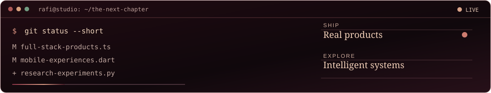
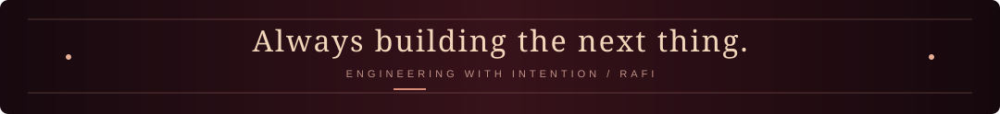

<!--
  THE RAFI STUDIO / PROFILE README
  The bespoke SVG graphics live in /assets and animate inside image elements.
  Live statistics below are supplied by third-party services; never hardcode counts.
  No JavaScript, personal access tokens, or secrets are required to render this page.
-->
<div align="center">

<a href="https://shajedulkabir.me"></a>

<br>


<br>

<a href="https://shajedulkabir.me"></a>
<a href="https://www.linkedin.com/in/shajedul-kabir-rafi-4489122b2"></a>
<a href="mailto:shajidulkabir12345@gmail.com"></a>

<br><br>


<br>

<a href="#01--the-human-behind-the-code">ABOUT</a> &nbsp;·&nbsp;
<a href="#02--current-chapters">WORK</a> &nbsp;·&nbsp;
<a href="#03--the-curated-archive">PROJECTS</a> &nbsp;·&nbsp;
<a href="#04--technical-universe">STACK</a> &nbsp;·&nbsp;
<a href="#05--research-lab">RESEARCH</a> &nbsp;·&nbsp;
<a href="#07--github-observatory">ANALYTICS</a>

</div>

---

## 01 / THE HUMAN BEHIND THE CODE

<a href="https://shajedulkabir.me"></a>

I'm **Shajedul Kabir Rafi**, a software engineer from **Dhaka, Bangladesh**. I build full-stack products, cross-platform mobile applications, and creative web experiences—and explore AI, computer vision, and research when the problem calls for a different kind of thinking.

I enjoy the complete process: translating a messy problem into a clear interface, building the system underneath it, then polishing the parts users can actually feel.

> **IDEAS MADE REAL.** *Engineering with intention.*

```typescript
const rafi = {
  building: ["production software", "mobile products", "interactive web"],
  exploring: ["applied AI", "computer vision", "research"],
  philosophy: "Understand the problem. Build deliberately. Keep improving.",
  location: "Dhaka, Bangladesh",
  currentMode: "always building the next thing"
};
```

## 02 / CURRENT CHAPTERS

| Chapter | Role | Where / Since |
| :-- | :-- | :-- |
| **01 · DataPulse Global** | Junior Software Engineer | Dhaka · Jun 2026 – Present |
| **02 · Boraq** | Full Stack Developer | Remote · Jun 2026 – Present |
| **03 · AUST Robotics Club** | Director, Web & App Development | AUST · Jul 2026 – Present |

<details>
<summary><b>↳ Open my professional engineering notebook</b></summary>
<br>

**DataPulse Global** — Internal business software, event and office management workflows, and reliable operational systems.

**Boraq** — Collaborative startup products including meeting and data-collection workflows. AI enhancements under development are not presented as already launched.

**AUST Robotics Club** — Technical direction and contributions across the club's web/mobile ecosystem, including its Flutter application and event-related work.

**Academic context:** Computer Science & Engineering at Ahsanullah University of Science and Technology (AUST).

</details>

## 03 / THE CURATED ARCHIVE

<div align="center">
  <sub>SELECTED WORK  /  SYSTEMS, MOBILE, INTELLIGENCE, CREATIVE CODE</sub>
  <br><br>
</div>

<table><tbody>
<tr>
<td width="50%" valign="top"><a href="https://github.com/Rafi12234/Make-My-Event-Office-Management-System"></a><br><sub><strong>01 / SOFTWARE SYSTEMS</strong></sub><br><b><a href="https://github.com/Rafi12234/Make-My-Event-Office-Management-System">MAKE MY EVENT ↗</a></b><br>Internal office operations, event workflows, client and staff coordination.<br><sub>Prisma · MySQL · modular APIs</sub></td>
<td width="50%" valign="top"><a href="https://github.com/Rafi12234/Sicko-Soul-Website"></a><br><sub><strong>02 / CLIENT EXPERIENCE</strong></sub><br><b><a href="https://github.com/Rafi12234/Sicko-Soul-Website">SICKO SOUL ↗</a></b><br>Expressive, motion-led digital storefront for an independent streetwear identity.<br><sub>Next.js · GSAP · Lenis · OGL</sub></td>
</tr>
<tr>
<td width="50%" valign="top"><a href="https://github.com/Rafi12234/SafePath-BD"></a><br><sub><strong>03 / GEO-SPATIAL WEB</strong></sub><br><b><a href="https://github.com/Rafi12234/SafePath-BD">SAFEPATH BD ↗</a></b><br>Community road-safety reports and incident-aware route exploration.<br><sub>ASP.NET Core · Leaflet · OSRM</sub></td>
<td width="50%" valign="top"><a href="https://github.com/Rafi12234/AUST-Robotics-Club-Mobile-Application"></a><br><sub><strong>04 / MOBILE PRODUCT</strong></sub><br><b><a href="https://github.com/Rafi12234/AUST-Robotics-Club-Mobile-Application">AUST ROBOTICS MOBILE ↗</a></b><br>Flutter app for club events, announcements, and community updates.<br><sub>Flutter · Dart · REST APIs</sub></td>
</tr>
<tr>
<td width="50%" valign="top"><a href="https://github.com/Rafi12234/AI-ASSISTED-DEEPFAKE-IMAGE-AND-VIDEO-DETECTION-SYSTEM"></a><br><sub><strong>05 / AI + MEDIA</strong></sub><br><b><a href="https://github.com/Rafi12234/AI-ASSISTED-DEEPFAKE-IMAGE-AND-VIDEO-DETECTION-SYSTEM">DEEPFAKE DETECTION ↗</a></b><br>AI-assisted image/video verification architecture and risk-signal workflows.<br><sub>Next.js · FastAPI · PyTorch</sub></td>
<td width="50%" valign="top"><a href="https://github.com/Rafi12234/FlareSphere-Real-Time-Hand-Tracking-Fireball-Effect"></a><br><sub><strong>06 / CREATIVE CODING</strong></sub><br><b><a href="https://github.com/Rafi12234/FlareSphere-Real-Time-Hand-Tracking-Fireball-Effect">FLARESPHERE ↗</a></b><br>Gesture-driven particle graphics through real-time hand tracking.<br><sub>React · MediaPipe · Canvas</sub></td>
</tr>
</tbody></table>

<sub>Cover images are illustrative portfolio artwork, not actual product screenshots. Repository READMEs provide implementation context; features still under development are not presented as shipped.</sub>

<details>
<summary><b>↳ Explore more projects from the 18-project portfolio</b></summary>

| Project | Area | Repository |
| :-- | :-- | :-- |
| **Smart Inventory** | Inventory systems | [Source ↗](https://github.com/Rafi12234/Smart-Inventory-Demand-Prediction-Management-System) |
| **CareerPath** | Career development | [Source ↗](https://github.com/Rafi12234/CareerPath-Ultimate-Solution-for-Youth-Career-Development) |
| **RideSplit** | Location / sharing | [Source ↗](https://github.com/Rafi12234/RideSplit) |
| **HerCue** | Everyday mobile companion | [Source ↗](https://github.com/Rafi12234/HerCue) |
| **PixelText** | Image/text encoding | [Source ↗](https://github.com/Rafi12234/PixelText---Image-Text-Encoder) |
| **Insurance Prediction** | Machine learning | [Source ↗](https://github.com/Rafi12234/Insurance_charges_prediction-using-Machine-Learning) |
| **DocMind AI** | Document workspaces; RAG planned | [Source ↗](https://github.com/Rafi12234/RAG-Based-Personalized-Chat-Bot) |
| **Head Detection** | Computer vision | [Source ↗](https://github.com/Rafi12234/Deep-Learning-Based-Head-Detection-System) |

</details>

<div align="center">
<a href="https://shajedulkabir.me/#projects"><b>DISCOVER THE FULL PORTFOLIO ↗</b></a>
&nbsp;&nbsp;·&nbsp;&nbsp;
<a href="https://github.com/Rafi12234?tab=repositories"><b>ALL REPOSITORIES ↗</b></a>
</div>

## 04 / TECHNICAL UNIVERSE

<div align="center">

</div>

| Practice | Main tools |
| :-- | :-- |
| **Frontend & motion** | TypeScript, JavaScript, React, Next.js, Astro, Tailwind, GSAP, Lenis |
| **Backend & systems** | Node.js, Express, FastAPI, ASP.NET Core, Prisma |
| **Mobile engineering** | Flutter, Dart, React Native, Expo |
| **Data & infrastructure** | MySQL, PostgreSQL, Firebase, Git, GitHub, Vercel, Cloudinary |
| **AI & scientific computing** | Python, PyTorch, OpenCV, YOLO, scikit-learn |

<sub>These are technologies used across different projects—not self-awarded proficiency scores.</sub>

## 05 / RESEARCH LAB

My research interests include **multimodal understanding**, **computer vision**, **zero-trust systems**, **geospatial health**, and **medical image analysis**.

| Work | Status |
| :-- | :-- |
| **BanglaFakeMMD** · Multimodal Bangla fake-news detection | Accepted & presented |
| **Visual Inattention Profiling** · YOLO + OCR driver monitoring | Accepted for presentation |
| **CA–DAC** · AI-augmented constraint-aware zero-trust framework | Accepted · eCF completed |
| **Child Malnutrition Spatial Prediction** · Satellite/climate/socioeconomic indicators | Proposal submitted |
| **Histopathology Image Classification** · Medical-image investigation | Research in progress |

<a href="https://shajedulkabir.me/#research"><b>EXPLORE THE SIX-RECORD RESEARCH ARCHIVE ↗</b></a>

## 06 / HONOURS & RECOGNITION

| Highlight | Context |
| :-- | :-- |
| **Hackathon Champion** 🏆 | AUST CSE Carnival 7.0 · Team NULL · 2026 |
| **Best Panel Member** | AUST Robotics Club · Fall 2024 panel, awarded Jan 2026 |
| **Research Symposium — 1st Runner-Up** | Research Symposium 1.0 · Team Respire · 2025 |

<a href="https://shajedulkabir.me/#achievements"><b>VIEW THE ACHIEVEMENTS AND EVIDENCE ↗</b></a>

## 07 / GITHUB OBSERVATORY

<div align="center">
  <sub>LIVE TELEMETRY  /  PUBLIC GITHUB ACTIVITY</sub><br><br>
  <a href="https://github.com/Rafi12234"></a>
  <a href="https://github.com/Rafi12234?tab=repositories"></a>
  <br><br>
  <a href="https://github.com/Rafi12234"></a>
  <br><br>
  
</div>

<details>
<summary><b>↳ Expand the animated 3D contribution field</b></summary>
<br>
<div align="center">
  
</div>
<sub>This optional visualization is served by an external image provider; it may occasionally be unavailable.</sub>
</details>

<details>
<summary><b>↳ Expand additional GitHub analytics</b></summary>
<br>
<div align="center">


</div>
</details>

<sub>Dynamic cards are rendered by third-party services and may cache results or hit rate limits. Language cards reflect repository code composition, not skill proficiency. Private contributions may not appear.</sub>

## 08 / THE WEBSITE IS LIVE

<div align="center">
<a href="https://shajedulkabir.me"></a>
<br>
<b><a href="https://shajedulkabir.me">shajedulkabir.me ↗</a></b>
<br>
<sub>Motion-led editorial portfolio · Astro · TypeScript · GSAP · Lenis · Cloudinary</sub>
<br><br>
<a href="https://github.com/Rafi12234/Portfolio---Shajedul-Kabir-Rafi">SOURCE CODE ↗</a>
&nbsp;·&nbsp;
<a href="https://shajedulkabir.me">LIVE EXPERIENCE ↗</a>
</div>

---

<div align="center">

<br><br>
<a href="mailto:shajidulkabir12345@gmail.com"><b>EMAIL</b></a> &nbsp;•&nbsp;
<a href="https://www.linkedin.com/in/shajedul-kabir-rafi-4489122b2"><b>LINKEDIN</b></a> &nbsp;•&nbsp;
<a href="https://github.com/Rafi12234"><b>GITHUB</b></a> &nbsp;•&nbsp;
<a href="https://www.instagram.com/___r_._a_._f_._i___/?hl=en"><b>INSTAGRAM</b></a>
<br><br>
<sub>SHAJEDUL KABIR RAFI / DHAKA, BANGLADESH / 2026</sub>
</div>
