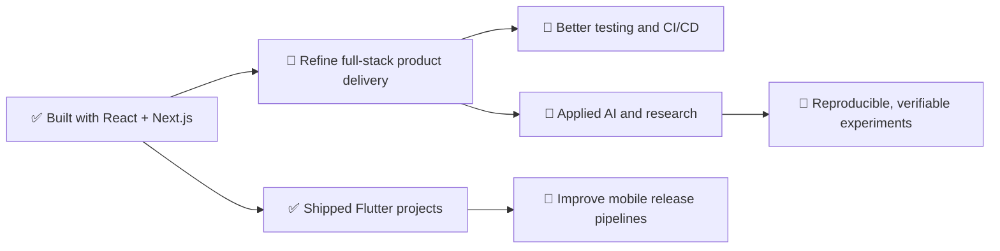

<!-- SHAJEDUL KABIR RAFI · GitHub profile README -->
<!-- Visual direction: burgundy / obsidian / parchment, inspired by shajedulkabir.me -->
<!-- Animations are rendered by image services because GitHub Markdown does not allow arbitrary JavaScript. -->

<div align="center">

  <!-- ════════════════════ ORIGINAL-STYLE ANIMATED INTRO ════════════════════ -->
  <a href="https://shajedulkabir.me">
    
  </a>

  <br/>

  

  <br/>

  <!-- Keeping your animated visitor area, now in the portfolio palette -->
  

  <p>
    
    
    
  </p>

  <!-- Alternate visitor analytics (from original README) -->
  <table align="center">
    <tr>
      <td align="center">
        <a href="https://visitorbadge.io/status?path=Rafi12234">
          
        </a>
      </td>
      <td align="center">
        <a href="https://visitorbadge.io/status?path=Rafi12234">
          
        </a>
      </td>
    </tr>
  </table>

  

</div>

<div align="center">

  <!-- Current status: updated instead of the old unverified Open to Work label -->
  <p>
    
    
    
  </p>

  

  <br/>

  

  <br/>
  

  

  <br/>

  <a href="https://shajedulkabir.me"></a>
  <a href="https://www.linkedin.com/in/shajedul-kabir-rafi-4489122b2"></a>

</div>

### 👨‍💻 About me

I'm **Shajedul Kabir Rafi**, a software engineer based in **Dhaka, Bangladesh**, working on real-world web systems, mobile applications, and creative digital experiences. Beyond application development, I'm interested in research and practical AI, especially computer vision and multimodal systems.

```typescript
const rafi = {
  location: "Dhaka, Bangladesh 🇧🇩",
  university: "Ahsanullah University of Science and Technology",
  roles: [
    "Junior Software Engineer · DataPulse Global",
    "Full Stack Developer · Boraq",
    "Director, Web & App Development · AUST Robotics Club"
  ],
  building: ["Full-stack products", "Flutter apps", "Creative web"],
  researching: ["Computer vision", "Multimodal AI", "Intelligent systems"],
  principle: "Ideas made real. Engineering with intention.",
  debugStrategy: "console.log() is still my friend ☕"
};
```

---
<!-- ═══════════════════════════════════════════════════════════════ -->
<!--                  ⚡ TECH STACK & EXPERTISE                     -->
<!-- ═══════════════════════════════════════════════════════════════ -->

<div align="center">

## ⚡ Tech Stack & Expertise


<br/>


</div>

<br/>
<!-- ═══════════════════════ LANGUAGES ═══════════════════════ -->
<div align="center">

### 「 💻 Programming Languages 」

<br/>

<a href="https://skillicons.dev">
  
</a>

</div>

<br/>

<!-- ═══════════════════════ FRAMEWORKS ═══════════════════════ -->
<div align="center">

### 「 🎨 Frontend & Frameworks 」

<br/>

<a href="https://skillicons.dev">
  
</a>

</div>

<br/>

<!-- ═══════════════════════ MOBILE ═══════════════════════ -->
<div align="center">

### 「 📱 Mobile Development 」

<br/>

<a href="https://skillicons.dev">
  
</a>

</div>

<br/>

<!-- ═══════════════════════ BACKEND ═══════════════════════ -->
<div align="center">

### 「 ⚙️ Backend & Database 」

<br/>

<a href="https://skillicons.dev">
  
</a>

</div>

<br/>

<!-- ═══════════════════════ TOOLS ═══════════════════════ -->
<div align="center">

### 「 🔧 DevOps & Tools 」

<br/>

<a href="https://skillicons.dev">
  
</a>

</div>

<br/>

<!-- ═══════════════════════ AI/ML ═══════════════════════ -->
<div align="center">

### 「 🤖 AI/ML & Data Science 」

<br/>

<a href="https://skillicons.dev">
  
</a>

<br/><br/>

<!-- Additional AI/ML icons using devicons -->
<p>
  
  
  
  
</p>

</div>

<br/>

<!-- ═══════════════════════ SKILL ICONS ═══════════════════════ -->
<div align="center">

### 「 🎯 All Technologies at a Glance 」

<br/>

<a href="https://skillicons.dev">
  
</a>

</div>

<br/>

<!-- ═══════════════════════ ANIMATED ICONS ═══════════════════════ -->
<div align="center">

### 「 ⚡ Core Competencies 」

<br/>

<p>
  
  
  
  
  
  
  
  
  
  
</p>

</div>

<br/>

<!-- ═══════════════════════ SKILL BARS ═══════════════════════ -->
<div align="center">

### 「 📊 Skill Focus — Self-Assessed 」

<sub>Illustrative self-ratings carried over from my earlier profile. Not external assessments.</sub>

<br/>

| 🏷️ Category | 🛠️ Technologies | 📈 Proficiency |
|:----------:|:----------------|:--------------:|
| **Frontend** | React, Next.js, TypeScript, Astro |  |
| **Mobile** | Flutter, Dart, Android |  |
| **Backend** | Node.js, Express, FastAPI |  |
| **Database** | MySQL, PostgreSQL, Firebase |  |
| **Languages** | TypeScript, JavaScript, Dart, Python |  |
| **DevOps** | Git, GitHub Actions, Docker |  |
| **AI/ML** | Python, PyTorch, OpenCV |  |

</div>

<br/>

<div align="center">


<br/>

<!-- Stats Summary -->
<p>
  
  
  
</p>

</div>

## 🚀 Featured Projects

<div align="center">


<br/>


</div>

<br/>

<!-- TWO-COLUMN PROJECT SHOWCASE — same visual pattern as my original README -->
<table align="center" border="0" cellpadding="18" cellspacing="0">
<tr>
<td width="50%" valign="top">

  <div align="center">

    

    <br/><br/>

    <a href="https://github.com/Rafi12234/Make-My-Event-Office-Management-System"></a>

    <br/><br/>

    

  </div>

  <br/>

  <blockquote><strong>MAKE MY EVENT</strong> — Internal office and event-management workflows for coordinating day-to-day operations.</blockquote>

  <table>
      <tr><td>✦</td><td>Client, meeting, and staff workflows</td></tr>
      <tr><td>✦</td><td>Attendance, vendor, and finance records</td></tr>
      <tr><td>✦</td><td>PDF proposals and event operations</td></tr>
  </table>

  <sub>Prisma · MySQL · modular APIs</sub>

  <br/><br/>

  <div align="center">
    <a href="https://github.com/Rafi12234/Make-My-Event-Office-Management-System"></a>
  </div>

</td>
<td width="50%" valign="top">

  <div align="center">

    

    <br/><br/>

    <a href="https://github.com/Rafi12234/Sicko-Soul-Website"></a>

    <br/><br/>

    

  </div>

  <br/>

  <blockquote><strong>SICKO SOUL</strong> — A dark editorial digital experience for an independent streetwear brand.</blockquote>

  <table>
      <tr><td>✦</td><td>Motion-led website and page transitions</td></tr>
      <tr><td>✦</td><td>Custom visual storytelling</td></tr>
      <tr><td>✦</td><td>GSAP and Lenis interactions</td></tr>
  </table>

  <sub>Next.js 15 · React 19 · GSAP · Lenis · OGL</sub>

  <br/><br/>

  <div align="center">
    <a href="https://github.com/Rafi12234/Sicko-Soul-Website"></a>
  </div>

</td>
</tr>
<tr><td colspan="2"></td></tr>
<tr>
<td width="50%" valign="top">

  <div align="center">

    

    <br/><br/>

    <a href="https://github.com/Rafi12234/SafePath-BD"></a>

    <br/><br/>

    

  </div>

  <br/>

  <blockquote><strong>SAFEPATH BD</strong> — Incident-aware road-safety reporting and map-based route exploration.</blockquote>

  <table>
      <tr><td>✦</td><td>Community reports and moderation</td></tr>
      <tr><td>✦</td><td>Alternative routes around verified incidents</td></tr>
      <tr><td>✦</td><td>Leaflet / OSRM map integration</td></tr>
  </table>

  <sub>ASP.NET Core · C# · Leaflet · OSRM</sub>

  <br/><br/>

  <div align="center">
    <a href="https://github.com/Rafi12234/SafePath-BD"></a>
  </div>

</td>
<td width="50%" valign="top">

  <div align="center">

    

    <br/><br/>

    <a href="https://github.com/Rafi12234/AUST-Robotics-Club-Mobile-Application"></a>

    <br/><br/>

    

  </div>

  <br/>

  <blockquote><strong>AUST ROBOTICS APP</strong> — A cross-platform mobile experience for AUST Robotics Club.</blockquote>

  <table>
      <tr><td>✦</td><td>Events and club announcements</td></tr>
      <tr><td>✦</td><td>Community and member updates</td></tr>
      <tr><td>✦</td><td>Cross-platform Flutter interface</td></tr>
  </table>

  <sub>Flutter · Dart · REST APIs</sub>

  <br/><br/>

  <div align="center">
    <a href="https://github.com/Rafi12234/AUST-Robotics-Club-Mobile-Application"></a>
  </div>

</td>
</tr>
<tr><td colspan="2"></td></tr>
<tr>
<td width="50%" valign="top">

  <div align="center">

    

    <br/><br/>

    <a href="https://github.com/Rafi12234/AI-ASSISTED-DEEPFAKE-IMAGE-AND-VIDEO-DETECTION-SYSTEM"></a>

    <br/><br/>

    

  </div>

  <br/>

  <blockquote><strong>DEEPFAKE DETECTION</strong> — AI-assisted media verification focused on interpretable risk signals.</blockquote>

  <table>
      <tr><td>✦</td><td>Image/video analysis architecture</td></tr>
      <tr><td>✦</td><td>Confidence-based review signals</td></tr>
      <tr><td>✦</td><td>Human-in-the-loop workflow design</td></tr>
  </table>

  <sub>Next.js · FastAPI · PyTorch · OpenCV</sub>

  <br/><br/>

  <div align="center">
    <a href="https://github.com/Rafi12234/AI-ASSISTED-DEEPFAKE-IMAGE-AND-VIDEO-DETECTION-SYSTEM"></a>
  </div>

</td>
<td width="50%" valign="top">

  <div align="center">

    

    <br/><br/>

    <a href="https://github.com/Rafi12234/FlareSphere-Real-Time-Hand-Tracking-Fireball-Effect"></a>

    <br/><br/>

    

  </div>

  <br/>

  <blockquote><strong>FLARESPHERE</strong> — A gesture-controlled cinematic fireball powered by hand tracking.</blockquote>

  <table>
      <tr><td>✦</td><td>MediaPipe hand landmarks</td></tr>
      <tr><td>✦</td><td>Live canvas particle system</td></tr>
      <tr><td>✦</td><td>Gesture smoothing and interaction</td></tr>
  </table>

  <sub>React · MediaPipe · Canvas · Vite</sub>

  <br/><br/>

  <div align="center">
    <a href="https://github.com/Rafi12234/FlareSphere-Real-Time-Hand-Tracking-Fireball-Effect"></a>
  </div>

</td>
</tr>
</table>

<div align="center">

<sub>Project covers are portfolio concept artwork rather than screenshots of the applications. Each repository documents its own current scope.</sub>

<br/><br/>

[](https://shajedulkabir.me/#projects)

</div>

---

## 🧪 Mini Projects & Experiments

<div align="center">


</div>

<br/>
<details>
<summary>

</summary>

<br/>

<div align="center">

| Project | What it explores | Stack |
| :-- | :-- | :-- |
| [**CareerPath**](https://github.com/Rafi12234/CareerPath-Ultimate-Solution-for-Youth-Career-Development) | Career planning, skill-gap tools and career-development workflows | React · Laravel · MySQL |
| [**Smart Inventory**](https://github.com/Rafi12234/Smart-Inventory-Demand-Prediction-Management-System) | Inventory, warehouse operations and reporting | Next.js · MySQL |
| [**RideSplit**](https://github.com/Rafi12234/RideSplit) | Destination-aware ride matching, maps, and chat | React · Firebase |

</div>

</details>

<details>
<summary>

</summary>

<br/>

<div align="center">

| Project | What it explores | Stack |
| :-- | :-- | :-- |
| [**HerCue**](https://github.com/Rafi12234/HerCue) | Everyday reminders and personal organization | React Native · Expo |
| [**PixelText**](https://github.com/Rafi12234/PixelText---Image-Text-Encoder) | Image-to-text encoding, compression, and decoding | Flutter · Dart |
| [**NutriTrack**](https://github.com/Rafi12234/NutriTrack) | Nutrition-oriented Flutter project; features still being documented | Flutter · Dart |
| [**AUST Students**](https://github.com/Rafi12234/Student-Management-System-for-AUSTians) | Student-oriented Flutter app; feature inventory needs confirmation | Flutter · Dart |

</div>

</details>

<details>
<summary>

</summary>

<br/>

<div align="center">

| Project | What it explores | Stack |
| :-- | :-- | :-- |
| [**DocMind AI**](https://github.com/Rafi12234/RAG-Based-Personalized-Chat-Bot) | Authenticated document workspaces and uploads; RAG planned | React · Express · Prisma |
| [**Insurance Prediction**](https://github.com/Rafi12234/Insurance_charges_prediction-using-Machine-Learning) | Regression experiments and interactive Gradio demo | Python · scikit-learn |
| [**Head Detection**](https://github.com/Rafi12234/Deep-Learning-Based-Head-Detection-System) | Camera-based detection and counting pipeline | YOLO · FastAPI · React |

</div>

</details>

<details>
<summary>

</summary>

<br/>

<div align="center">

| Project | What it explores | Stack |
| :-- | :-- | :-- |
| [**LoveOS 2.0**](https://github.com/Rafi12234/LoveOS-v2.0) | Interactive personal creative experience | React · Framer Motion |
| [**AI Image Generator**](https://github.com/Rafi12234/Ai-Image-Generator) | Image-generation notebook experiment; model details not documented | Jupyter · GPU/CUDA |
| [**Flappy Bird**](https://github.com/Rafi12234/Flappy--Bird) | Classic game recreation from my early experiments | Game project |
| [**Tic Tac Toe**](https://github.com/Rafi12234/tic-tac-toe) | Small interactive game experiment | Game project |
| [**Calculator App**](https://github.com/Rafi12234/calculator_app) | Mini application and UI experiment | Utility |

</div>

</details>

<div align="center">


[](https://github.com/Rafi12234?tab=repositories)

<br/>


</div>

## 📊 GitHub Analytics

<div align="center">

<!-- Live analytics: values are supplied dynamically by external providers. -->


<br/><br/>


<br/><br/>


<br/><br/>


</div>

<details>
<summary>📈 Alternative Stats Dashboard (click to expand)</summary>

<br/>

<div align="center">


</div>

</details>

---

## 🌍 Global Contribution Insights

<div align="center">


<sub>External live widgets may sometimes fail to load or show cached data. Public-repo language charts do not measure skill proficiency.</sub>

</div>

---

## 🎯 Current Goals & Roadmap



### 🔥 In Progress
- 💻 Developing business and startup systems at **DataPulse Global** and **Boraq**.
- 📱 Building and improving digital experiences for **AUST Robotics Club**.
- 🧪 Exploring computer vision, research, and intelligent workflows.
- 🎛️ Improving usability, accessibility, and performance in interactive applications.

### ✅ Recently Completed & Showcased
- 🚀 Launched my interactive personal portfolio: **[shajedulkabir.me](https://shajedulkabir.me)**.
- 🛠️ Curated **18 selected projects** with verified repository links.
- 🏆 Earned **Hackathon Champion** at AUST CSE Carnival 7.0 with Team NULL.
- 📚 Expanded a research archive with accepted, submitted, and ongoing work clearly distinguished.

### ✨ Looking Ahead
- 🔐 Write stronger tests and security reviews around production projects.
- ⚙️ Streamline CI/CD and application release workflows.
- ✍️ Document engineering decisions and reproducible research more clearly.
- 🤝 Keep contributing to interesting teams and open-source projects.

---

## 🏆 Achievements & Highlights

<div align="center">

| Recognition | When | Context |
| :-- | :-- | :-- |
| 🥇 **Hackathon Champion** | Apr 2026 | AUST CSE Carnival 7.0 · Team NULL |
| 🏅 **Best Panel Member** | Jan 2026 | AUST Robotics Club · Fall 2024 Web Team panel |
| 🥈 **Research Symposium 1st Runner-Up** | Mar 2025 | IEOM Society, AUST Student Chapter · Team Respire |

[**Explore achievements and evidence ↗**](https://shajedulkabir.me/#achievements)

</div>

---

## 💭 Random Dev Quote

<div align="center">


</div>

---

## 🤝 Let's Connect!

<div align="center">

[](https://shajedulkabir.me)
[](https://www.linkedin.com/in/shajedul-kabir-rafi-4489122b2)
[](https://www.instagram.com/___r_._a_._f_._i___/?hl=en)
[](https://www.facebook.com/shajidul.kabir.5)
[](mailto:shajidulkabir12345@gmail.com)

<br/>

### 💬 "Build deliberately. Keep learning. Make it useful."

**If you enjoy a project, a star means a lot.** ⭐


<br/>

<!-- Footer visitor statistics: continuing the original profile's visual style -->
<p align="center">
  
  
  
</p>


<br/>


</div>